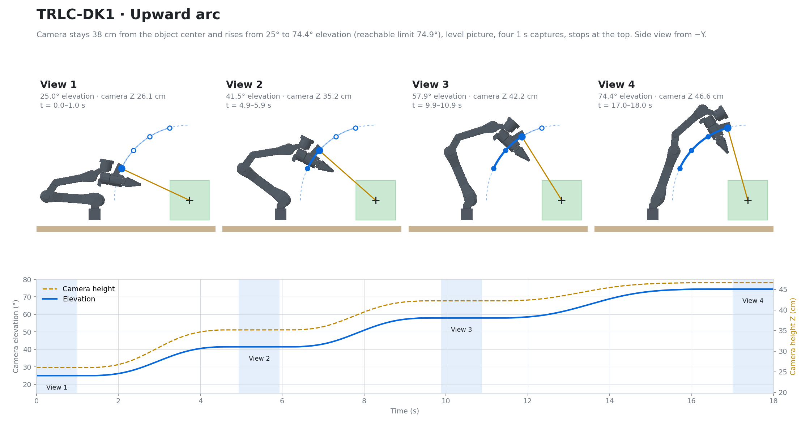

# TRLC-DK1 scanning demo

The arm moves a camera (phone) around an object, always pointing at its center.
There are two motions:

- **Upward arc** (`--mode upward_arc`): up an arc 38 cm from the object, stopping
  for 0.5 s at four photo positions, then back down, repeating.
- **Sweep** (`--mode sweep`): side to side around the object (130°) at constant
  speed, with no stops. It only slows down to turn around at the two ends.
  One cycle takes 5.7 s.



## You need

- Linux with [Docker](https://docs.docker.com/engine/install/)
- The TRLC-DK1 arm, powered on and connected by USB

## Run it

```bash
git clone https://github.com/GrzegorzCzput/robot_demonstracja_skanowanie.git
cd robot_demonstracja_skanowanie

./run_robot_docker.sh --dry-run           # try it without the robot
./run_robot_docker.sh --mode upward_arc   # run it on the robot
./run_robot_docker.sh --mode sweep        # side-to-side sweep
```

The first run builds the Docker image, which takes a minute or two. After that:

1. The script shows the arm's current position and waits. **Press Enter.**
2. The arm moves slowly to the start of the arc.
3. It repeats the motion until you stop it.

## Stop it

| Press | What happens |
|---|---|
| **Esc** | The arm goes back to where it started, then the motors turn off |
| **Ctrl+C** | Same, but asks before turning the motors off, so you can hold the arm |
| **Robot power switch** | Emergency stop |

When the motors turn off, the arm goes limp and drops.

## Options

| Option | Meaning |
|---|---|
| `--port /dev/ttyACM1` | The robot isn't on `/dev/ttyACM0`. Find it with `ls /dev/ttyACM*` |
| `--speed 1.5` | Slower or faster motion. Upward arc: default 3.5, max 3.73. Sweep: default 1.0, max 1.02 |
| `--hold 1` | Upward arc: photo stop length in seconds (the default is 0.5) |
| `--loops 320` | Stop after 320 cycles (11 s each for the arc, 5.7 s for the sweep) |
| `--once` | Upward arc: go up once and stop at the top |

## Before the first run

- Clear the area around the robot. The move to the start of the arc and the move
  back home are not collision checked.
- Start with the arm in a low, safe pose. It returns there at the end.
- Try a slow speed first (`--speed 1.5` for the arc, `--speed 0.5` for the sweep),
  without the object on the table.
- Keep a hand near the power switch.

Both motions follow paths planned with collision checking in simulation. The sweep
follows the planned path to within 0.8 mm. The planner,
simulation viewer and the four-view scan are on the
[`full-project`](https://github.com/GrzegorzCzput/robot_demonstracja_skanowanie/tree/full-project)
branch.
